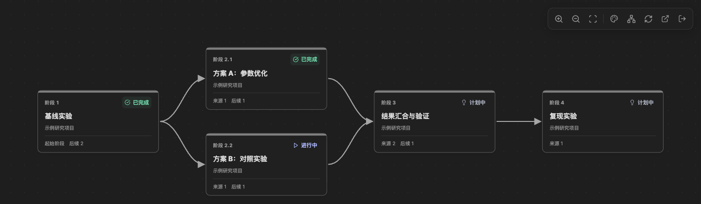
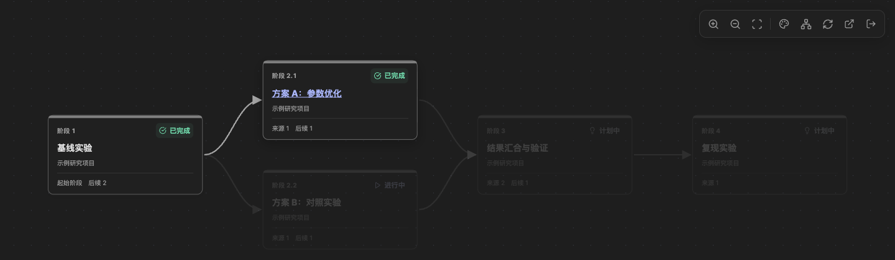
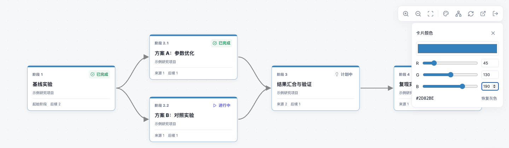
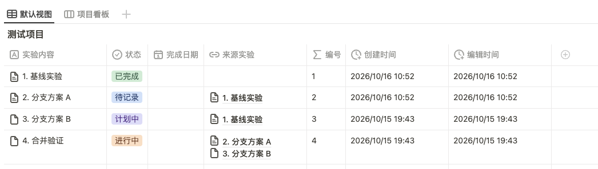
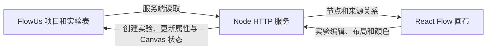

# FlowUs Helix Project Canvas

把 FlowUs 项目中的实验记录与「来源实验」关联，展示成可以嵌入项目页面的流程图。它适合有推进、分支、合并的研究过程：记录继续写在 FlowUs，画布负责呈现阶段之间的关系。

这是个人自托管应用，不是 FlowUs 官方产品。卡片和上游高亮交互参考 Obsidian Helix 的使用方式。

## 界面预览

通过 FlowUs 的「嵌入网页」功能，将画布嵌入笔记，即可直接在笔记中获得下图所示的展示效果。

以下是本地应用的真实界面截图，使用合成示例数据，不包含实际研究内容。点击图片可查看原尺寸。

**分支与汇合**：一个基线分成两条实验路线，再汇合验证并继续推进。编号、状态和来源数量直接显示在卡片上。



**上游追溯**：悬停「方案 A」，保留该阶段及其全部上游来源，其他节点和连线淡化，便于专注查看一条研究路线。



**浅色主题与 RGB 调色**：主题跟随系统；调色盘实时更新卡片颜色，停止操作 3 秒后合并保存。



## 为什么这样做

实验过程经常出现一条线分成多个方案、多个结果再汇合的情况。表格便于记录与筛选，却不容易看清整个过程。维护另一套流程图连线，又容易与记录失去同步。

本项目直接读取每条实验的「来源实验」自关联，用页面 ID 标识节点。因此改标题或改编号不会断开连接；编号用于显示和同层排序，并在打开或刷新时按当前关系连续重编，写回标题前缀。**FlowUs 是唯一业务数据源**：实验内容、关系、已保存的节点位置和卡片颜色都保留在 FlowUs。关闭服务后，这些数据仍然存在。

服务不另建业务数据库。服务器磁盘只保存运行必需的认证文件；服务器图与模板缓存仅驻留内存；浏览器保存最近画布的可丢弃预览和观看位置。FlowUs 仍是唯一业务数据源，浏览器预览不参与写入校验。

## 能做什么

- 展示推进、分支与多来源汇合；悬停卡片高亮该阶段及全部上游来源。
- 按关系自动分层；打开或刷新时沿用 Ob Helix 的 DAG 连续编号思路，推进/合并用大号，分支用小号。同大号的分支小号全图去重。
- 自适应窗口、缩放、平移；系统明暗主题；带提示的紧凑图标按钮。
- RGB 调色即时预览；停止操作 3 秒后合并保存颜色和布局。
- 打开时尝试显示近期内存快照，再读取最新数据；之后由用户手动刷新。
- 悬停卡片可新增后续实验或修改来源连接；点击状态可写回 FlowUs。节点仍不可拖动，关系通过选择来源修改。
- 删除按钮先说明影响，再到 FlowUs 手动删除；返回打开或刷新画布后自动重编。手动自动排列仍用于调整布局。
- URL 使用 `/Helix/<项目简写>`；已有嵌入的简写变更可由后台同步，新嵌入仍需手动添加。

## QuickStart

需要 Node.js 24、npm、Python 3、Docker Compose，以及能访问并编辑目标内容的 FlowUs API token。以下命令面向 macOS/Linux，在自己的部署机器执行。

### 1. 准备 FlowUs 数据

建立一个项目多维表格，每条项目记录至少包含：

| 属性 | 类型 | 用途 |
| --- | --- | --- |
| 项目标题 | 标题 | 显示项目名，标题属性名称不限 |
| 项目 URL 名 | 文本 | 手动设置且在项目表内唯一，例如 `demo` |
| Canvas 状态 | 文本 | 留空；应用保存布局 JSON，可在表格日常视图中隐藏 |

在每个项目记录页面**直接放置一个属于该页面的实验子数据库**，包含：

| 属性 | 类型 | 用途 |
| --- | --- | --- |
| 实验标题 | 标题 | 记录标题，属性名称不限 |
| 来源实验 | 关联 | 指向该实验表自身，可选择多个来源；无需显示反向字段 |
| 编号 | 公式 | 返回字符串或数字；缺省时取标题第一个空格前的内容 |
| 状态 | 单选 | 用于卡片状态显示和点击修改；可选值取自表结构 |

「来源实验」名称固定；实验表必须是页面直属的真实子数据库，不能只是其他数据库的链接视图。项目简写允许字母、数字、中文、下划线及连字符，首字符必须是字母/数字/中文，总长不超过 80。

下面是 FlowUs 实验表的填写示例：



「基线实验」没有来源；「分支方案 A」和「分支方案 B」都选择「基线实验」作为来源，形成分支；「合并验证」同时选择方案 A 和方案 B，形成合并。画布根据这些关联自动生成连线，无需另外维护。

图中的完成日期、创建时间和编辑时间属性用于日常记录；自动编号使用 API 的页面创建时间，不依赖同名手动属性。

取得项目表的数据库 ID，并为 token 授权该表、项目页面、实验表及记录。应用需要读取内容、创建实验、修改实验标题/状态/来源，以及更新项目的 Canvas 状态；URL 同步还需要更新已有嵌入块。

### 实验模板

配置 `FLOWUS_EXPERIMENT_TEMPLATE_ID` 为现有、已授权给服务的**普通模板页面 ID**，不要填写数据库 ID。模板正文需要包含「本阶段问题聚焦」（也接受「本轮聚焦问题」）与「下一阶段聚焦问题」栏目。服务读取模板原生块生成新实验，不修改模板本身。

打开新增弹层时提前准备模板；提交仍核对版本，模板修改后自动重读。新增实验时复制模板，并把每个来源实验的「下一阶段聚焦问题」分别放入独立引述块，作为新实验的问题输入。多来源不会揉成一段。内容是**创建时快照**；之后改连接或修改来源正文，不持续同步已生成的正文。

支持复制段落、引述、折叠、一级至三级标题、有序/无序列表、待办、代码、公式、分隔线、提示块、表格及分栏，并保留支持的嵌套子块。富文本支持文本、行内公式和页面/用户/日期引用；提示块图标仅支持 emoji。媒体、子页及未知块会在创建前明确拒绝，不静默跳过。模板与来源正文合计最多 2,000 块、单层最多 100 块，嵌套深度上限 24。没有配置模板时不能使用新增实验功能，已有项目仍可读取。

### 2. 构建并配置

```sh
git clone https://github.com/DaveBraid/flowus-helix-project-canvas.git
cd flowus-helix-project-canvas
npm ci
npm test
npm run build
cp .env.example .env
```

编辑 `.env`，将 `FLOWUS_PROJECTS_DATABASE_ID` 改成自己的项目表 ID，并将 `FLOWUS_EXPERIMENT_TEMPLATE_ID` 改成上述模板页面 ID。首次本地试用保留 `PUBLIC_ORIGIN=http://localhost:3000`。

```sh
python3 ops/set-password.py --init
LOCAL_UID=$(id -u) LOCAL_GID=$(id -g) docker compose up -d --build
```

脚本隐藏输入个人登录密码（至少 9 位）和 FlowUs token，只保存密码哈希、随机会话密钥及 token。它们位于被 Git 忽略的 `secrets/`。容器以对应 UID/GID 读取这些私有文件。

访问 `http://localhost:3000/Helix/demo`，其中 `demo` 必须已存在于「项目 URL 名」。使用 **localhost**，不要换成 `127.0.0.1`，本地非 Secure Cookie 的判定依赖该地址。

### 3. 发布并嵌入

为服务配置自己的 HTTPS 域名和反向代理，转发到 `127.0.0.1:3000`。代理应覆盖 `X-Real-IP`，不要透传用户伪造的该请求头。将 `.env` 中 `PUBLIC_ORIGIN` 改为精确的外部来源，例如 `https://canvas.example.com`（不含结尾斜杠）。

```sh
LOCAL_UID=$(id -u) LOCAL_GID=$(id -g) docker compose up -d
```

在 FlowUs 项目页面手动插入嵌入网页，填写 `https://canvas.example.com/Helix/demo`。本地 HTTP 仅用于试用，不能作为 HTTPS FlowUs 页中的正式嵌入。

修改部署实例的个人密码：

```sh
python3 ops/set-password.py
```

成功写入后自动重启该 Compose 服务，旧会话失效。若直接使用 Node 运行，需要自行重启对应进程。

### 可选：服务端独立 OAuth

QuickStart 使用显式 token 文件，**不会自动刷新该 token**。仓库另保留 `CliOAuth` 适配器：通过服务器独立的官方 FlowUs CLI 授权目录，由 CLI 负责 OAuth 刷新，服务仅在内存使用 access token。

此路径需要自行安装与验证官方 CLI，并在服务器单独完成 OAuth 登录；不要复制正在使用的其他设备授权目录。配置 `FLOWUS_CONFIG_DIR`（绝对路径）、`FLOWUS_CLI_PATH`（绝对路径）、可选的 `FLOWUS_WORKSPACE_ID`。目录权限须为 `0700`，`credentials.json` 须为 `0600`，由运行服务的用户持有。容器还须挂载可写授权目录与适配目标 Linux 架构的 CLI，并替换 Compose 中的 token 配置；本仓库不分发 CLI 二进制。适配器按 CLI v0.3.13 的凭据格式实现，升级后应重新验证。

官方 API 与授权入口：[FlowUs 开发者文档](https://flowus.cn/developer-api/v2/zh)。

## 实现思路



- **前端**：React + React Flow。无环图按最长来源深度分层；循环图回退 ELK。跨层边经过行间通道，以平滑曲线减少穿卡片。
- **后端**：Node 原生 HTTP 服务调用 FlowUs API。复用数据库查询返回的关系；达到 20 条或响应提示截断/异常时，补读完整属性分页。
- **保存**：验证项目归属、当前节点及 ETag，避免旧窗口覆盖新数据。坐标和颜色写回原文本属性，不上传附件。
- **更新**：没有画布定时轮询。手动刷新绕过缓存，保留旧画布直到新数据就绪；服务器缓存最多 100 个项目，预览有效期最多 5 分钟。浏览器另保留最多 10 个项目、7 天的预览（每项最多 200 万字符），含卡片摘要、关系和显示坐标；再次打开先显示预览，后台校验完成前禁止编辑。退出登录清除画布预览；禁用存储时回退服务器预览。缩放和平移仅缓存在浏览器 localStorage，按项目 ID 区分，不写 FlowUs；存储不可用时降级为自适应。悬停不写入。
- **编号**：打开/刷新触发受保护的连续重编，改写标题编号前缀；以页面创建时间作为稳定顺序，同时间以页面 ID 排序。关系始终基于页面 ID。多记录更新不具有跨页事务，失败时应按提示刷新重试。
- **后台工作**：URL 巡检在启动约 5 秒后开始，每轮结束后等 60 秒。未改变简写时不逐项目读取子块。首次同步及更新已有嵌入依赖有效的 Canvas 状态，不能替代手动添加嵌入。
- **认证**：个人密码使用 scrypt 哈希。签名 Cookie 配合 CSRF 校验；HTTPS 使用 Secure、HttpOnly、SameSite=None、Partitioned。会话在北京时间下月 1 日 00:00 到期，不采用设备指纹。

## 边界与成本

1. 面向个人使用，共享单密码；没有多人角色、每项目权限或审计后台。只有已经授权给服务器的内容可读取，未知或重复简写会被拒绝。
2. 每项目须有且只有一个符合约定的实验子表；来源限定同表实验。关系存在循环或无法确认完整性时停止自动重编，防止错误写回；首次加载会尝试只读展示原图并保留错误提示，禁用编辑。依赖固定中文字段，尚无字段映射界面。
3. 保存最多 1,000 个节点且 JSON 不超过 64 KB，可能先达到字节上限；这不是大规模图的性能承诺。复杂循环、密集连线仍可能需要进一步优化。
4. FlowUs 是源数据，但服务器 token 可访问其授权范围；请只授权需要的项目。浏览器不接收 FlowUs token。
5. API 请求串行，至少间隔 600 毫秒，并对限流响应退避。大表、长关联分页和 URL 后台巡检仍消耗请求；不承诺固定加载时间，也不承诺供应商调用免费。
6. FlowUs 中修改关系或删除实验后，打开/刷新画布才会同步并重编；需要新层级布局时再点击自动排列。节点不可拖动。视口缓存只属于当前浏览器，清理浏览器数据后恢复自适应。
7. iframe 登录和打开 FlowUs 页面受客户端 Cookie、嵌入策略影响。服务 CSP 允许 FlowUs 官方域名嵌入；其他宿主需调整配置。
8. 已损坏或不属于当前项目的布局不会被静默覆盖。并发保存冲突需要刷新重试。

## 开发与测试

`npm test` 运行离线测试，不需要 FlowUs 凭据。测试覆盖鉴权、分页、冲突保护、缓存、URL 同步、自然排序和合成 20 节点/28 边布线。测试数据不包含实际研究项目。

前端开发可运行 `npm run dev`；Vite 的 `/api` 代理目标是 `http://127.0.0.1:8787`，需另行启动 `PORT=8787` 的后端并将 `PUBLIC_ORIGIN` 设为浏览器实际开发来源。首次使用推荐上面的构建后 Compose 路径。

## 许可证

本项目采用 [MIT 许可证](LICENSE)。

## 保存与发布可靠性修复

- 颜色/布局保存保留最后完成嵌入同步的 urlSlug；只有链接同步任务能推进该标记，避免改简写后保存颜色导致旧嵌入永久遗漏。
- 应用内退出会等待在途或待执行保存；保存失败/冲突时取消退出并保留修改。页面隐藏时尽早尝试保存，但宿主强制销毁 iframe 不能保证完成；离开前以“布局已保存”为准。
- `ops/release.py` 用独立候选目录发布，健康后保留当前资源及最近两版备份、当前及最近两版 Helix 镜像；旧哈希资源按入口递归引用清理。脚本仅管理 flowus-helix 镜像仓库和本项目目录，不做全局 Docker prune。新构建关闭共享 BuildKit 缓存，使用项目标签清理悬空镜像；历史共享 BuildKit 缓存因无法可靠归属，保留不动。

已有 Compose 部署可在本机完成 `npm run build` 后，将 `server/`、`dist/`、`Dockerfile` 放入部署目录 `.incoming/YYYYMMDDTHHMMSSZ/`，再执行 `python3 ops/release.py --root /absolute/deployment --candidate /absolute/deployment/.incoming/YYYYMMDDTHHMMSSZ`。需已有 `flowus-helix:local` 镜像、Docker Compose、Python 3，且该目录的 Compose 服务名为 helix。首次初始化仍使用 QuickStart。清理仅在健康检查成功后执行；构建或健康失败时恢复上一镜像和资源。
