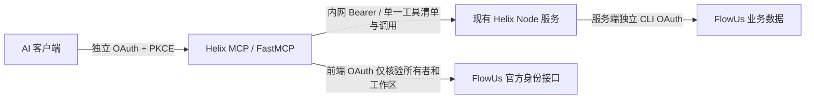

# Helix 远程 MCP

本目录仅提供传输和身份验证。业务工具及输入 schema 由现有 Node 服务的 `HelixActions` 唯一维护，业务数据保留在 FlowUs。



前端 OAuth grant 与 Node 后端 FlowUs grant 相互独立。前端 token 仅交给 FlowUs 官方身份验证与框架 OAuth，不进入 Node、不代替后端 grant、不返回客户端。MCP 客户端仅取得 FastMCP 针对本入口签发的凭据。

通过前端验证后，可执行 Node 清单内全部 Helix 工具，其业务范围由 Node 后端配置和 FlowUs 授权控制。前端授权页面所选页面范围不能用作业务范围限制；本服务只向指定所有者开放。

## 运行配置

`Dockerfile` 使用固定 Python 镜像摘要并按锁文件安装依赖，可独立构建：`docker build -t flowus-helix-mcp:local .`。独立本地开发环境可按 `requirements.lock` 安装依赖。容器启动目录为 `/app`，执行 `python gateway.py`。

| 变量 | 内容 |
| --- | --- |
| `HELIX_MCP_PUBLIC_BASE_URL` | `https://helix-mcp.example.com`，只允许 HTTPS 基址，不含路径 |
| `HELIX_MCP_STATE_DIR` | 专用持久化目录，默认 `/state`；禁止复用现有网关或 Node CLI OAuth 卷 |
| `HELIX_MCP_OWNER_ID` | 可信后端身份核验所得 FlowUs owner ID |
| `HELIX_MCP_WORKSPACE_ID` | 可信后端身份核验所得 FlowUs workspace ID |
| `HELIX_MCP_ALLOWED_REDIRECT_URIS` | MCP 客户端回调 URI 的 JSON 白名单；必须显式提供 |
| `HELIX_INTERNAL_URL` | Node 的 Docker 内网基址，默认 `http://helix:3000` |
| `HELIX_INTERNAL_TOKEN_FILE` | 与 Node 共享的只读机器密钥文件，至少 32 个无空白字符；支持同名无 `_FILE` 环境变量，优先读文件 |
| `HELIX_MCP_BIND_HOST` | 默认 `0.0.0.0`，容器内使用；本机直接运行时设 `127.0.0.1` |

常用客户端回调白名单示例：

```json
[
  "https://chatgpt.com/connector/oauth/*",
  "https://chatgpt.com/connector_platform_oauth_redirect",
  "http://127.0.0.1:*",
  "http://localhost:*"
]
```

新增客户端时，根据该客户端公开文档或实际注册请求增补精确模式。不要默认放开任意 HTTPS 域名。

容器运行账户需可写专用状态卷，属主与 `LOCAL_UID:LOCAL_GID` 一致（默认 `1000:1000`）。状态卷存放加密客户端注册、前端 OAuth 状态、加密密钥和 JWT 签名密钥；卷及备份须整体保留并限制访问。状态文件权限默认 `0600`，目录默认 `0700`。签名密钥和加密密钥丢失会使原有连接失效。

## 部署集成

1. 为 MCP 新建独立镜像/容器、专用状态卷；不要改旧 FlowUs MCP 网关。
2. 容器加入能访问现有 `helix:3000` 的业务内网，另加入 Caddy 入口网络。仅映射宿主机 `127.0.0.1:18771:18771` 供诊断。
3. Node 与 MCP 各挂载同一机器密钥文件。Node 以常量时间比较校验 Bearer；内部接口独立于画布 Cookie/CSRF。
4. 公网新 host 的 HTTPS 根路径全部反代至 MCP `18771`，使 `/.well-known/*`、`/authorize`、`/register`、`/token`、`/auth/callback`、`/mcp` 均到同一服务。画布 host 显式拒绝 `/internal/*`，不向公网暴露 Node 内部接口。
5. 配置环境后，在同一专用卷内运行 `python register_frontend.py`。该脚本只注册本服务的独立 PKCE 公共客户端，保存加密注册；重复运行复用相同注册，回调改变时拒绝覆盖。
6. 启动 `python gateway.py`。启动时最多尝试 5 次工具发现，每次超时 10 秒，等待总计 10 秒；认证、空清单或 schema 错误立即停止，绝不回退匿名模式。
7. 客户端添加 MCP URL `https://helix-mcp.example.com/mcp`，选择 OAuth，客户端 ID/密钥留空，由 DCR 注册。每个客户端首次接入时，用户需完成框架同意和 FlowUs 官方身份授权。

不要将任何 `HELIX_INTERNAL_TOKEN`、Node CLI OAuth 文件、旧网关状态文件或前端 OAuth token 放入 Skill/客户端配置。

## 内部契约

两端均使用 `Authorization: Bearer <独立机器密钥>`：

- `GET /internal/mcp/tools` → `{ "tools": [{ "name", "description", "inputSchema", "annotations"? }] }`。
- `POST /internal/mcp/call`，输入 `{ "name": "工具名", "arguments": { ... } }`；成功返回 HTTP 200 业务 JSON；失败返回对应状态及 `{ "error": "说明", ... }`。

MCP 不保存业务清单副本，启动时从 Node 加载；更新工具清单后重启 MCP。工具输入先按同一 schema 校验，再交给 Node 二次验证。业务调用最多等待 90 秒，任何错误均不自动重试写入。遇到超时/连接断开，写入可能已完成，先读回核对。

## 验证

```sh
PYTHONDONTWRITEBYTECODE=1 FASTMCP_CHECK_FOR_UPDATES=off python -m unittest -v test_gateway.py
```

测试使用真实 FastMCP HTTP/工具 API 和模拟身份/业务 HTTP 响应，不写 FlowUs。覆盖定义一致、机器认证隔离、输入验证、错误与重试、身份边界、状态加密和匿名拒绝。

上线后还需实际验证 TLS、发现元数据、用户交互 OAuth、工具清单、只读业务读取、重启授权复用及客户端原生调用。`GET /healthz` 只报告进程及已载入工具数，不证明 OAuth 流程或业务服务当前可用。首次验收不强制执行真实业务写入。

实现依据：FastMCP 官方 [OAuthProxy 文档](https://github.com/PrefectHQ/fastmcp/blob/main/docs/servers/auth/oauth-proxy.mdx)；当前版本的真实 API 已在单测中验证。


## 通用 Compose 启动示例

先按根目录 QuickStart 完成画布服务与 FlowUs 后端授权。以下命令均在仓库根目录执行；复用同一个 Compose 项目，不要求额外的外部 Docker 网络。

```sh
cp mcp/settings.env.example mcp/settings.env
```

编辑 `mcp/settings.env`，填写自己的 HTTPS MCP 域名、可信 FlowUs 所有者和工作区 ID、实际客户端回调白名单。owner/workspace 应由已信任的服务端身份取得，不能使用任意来访客户端提交的值；它们是标识符，不是 API token。

```sh
export LOCAL_UID=$(id -u) LOCAL_GID=$(id -g)
python3 - <<'PY'
import os, secrets
from pathlib import Path
os.umask(0o077)
Path('mcp/state').mkdir(mode=0o700, parents=True, exist_ok=True)
Path('secrets').mkdir(mode=0o700, exist_ok=True)
# 使用排他创建，已有机器密钥保持原样。
try:
    with Path('secrets/mcp-internal-token').open('x') as stream:
        stream.write(secrets.token_hex(32) + '\n')
except FileExistsError:
    pass
PY
# 后续管理 MCP 时继续使用相同的两个配置文件。
dc() { docker compose --env-file .env --env-file mcp/settings.env -f compose.yaml -f mcp/compose.example.yaml "$@"; }
dc build helix mcp
dc up -d helix
dc run --rm --no-deps mcp python register_frontend.py
dc up -d mcp
```

先按 `Caddyfile.example` 设置 MCP 的独立 HTTPS host；该示例面向运行在宿主机上的 Caddy。若反代运行在容器内，应将它加入相同网络并将 upstream 改为 `mcp:18771`。同时在画布 host 的既有路由中显式拒绝 `/internal/*`；合并前备份并验证配置，不要覆盖其他服务的入口。

机器密钥必须供两个服务账户读取，状态目录必须仅供 MCP 账户读写。已有目录权限/属主不正确时应修正对应目录，不要放宽成全用户可读。注册只创建独立前端 OAuth 客户端；首次使用仍需用户完成交互授权。

```sh
curl --fail https://helix-mcp.example.com/.well-known/oauth-authorization-server
curl --silent --output /dev/null --write-out '%{http_code}\n' https://helix-mcp.example.com/mcp
```

匿名 MCP 端点应返回 401。健康检查仅用于部署诊断，不能替代真实 OAuth 和业务调用验收。此示例不包含任何个人服务器的 SSH、镜像保留或发布脚本。

## 验收记录（2026-10-27）

已有部署完成：Node 内部清单与 MCP sidecar 均载入 18 个工具；TLS/OAuth 发现元数据返回 200，匿名 MCP 返回 401，外网内部路由返回 404。测试项目验证了正文增量写入、附件 PUT 与原生块回读、实验创建/状态更新/删除后重编；隔离测试表验证了空白项目创建、改名与简写更新。

本机 Codex 已完成 DCR/OAuth 授权，并在原生 app-server 临时上下文中发现 18 个工具，成功调用帮助及测试项目读取；未执行业务写入。当前活动对话可能尚未重载工具，不能仅凭配置成功认定该对话已可调用。ChatGPT 网页插件连接仍未验证。当前页面级授权下回收站恢复仍为 403，本次未扩大授权。上述已有部署结果不替代新环境的镜像构建、权限及客户端验收。

## 本机 Codex 接入

先检查现有连接，避免重复添加：

```sh
codex mcp list
```

确认尚无同名连接后，将示例域名替换为自己的部署入口：

```sh
codex mcp add flowus-helix --url https://helix-mcp.example.com/mcp --oauth-client-registration dcr
```

按提示完成 OAuth。配置后需在实际使用的对话中确认工具已加载；已有活动对话可能需要重新加载。此方式直接注册远程 MCP，不依赖网页插件安装链接。
